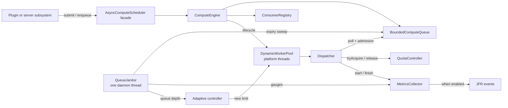
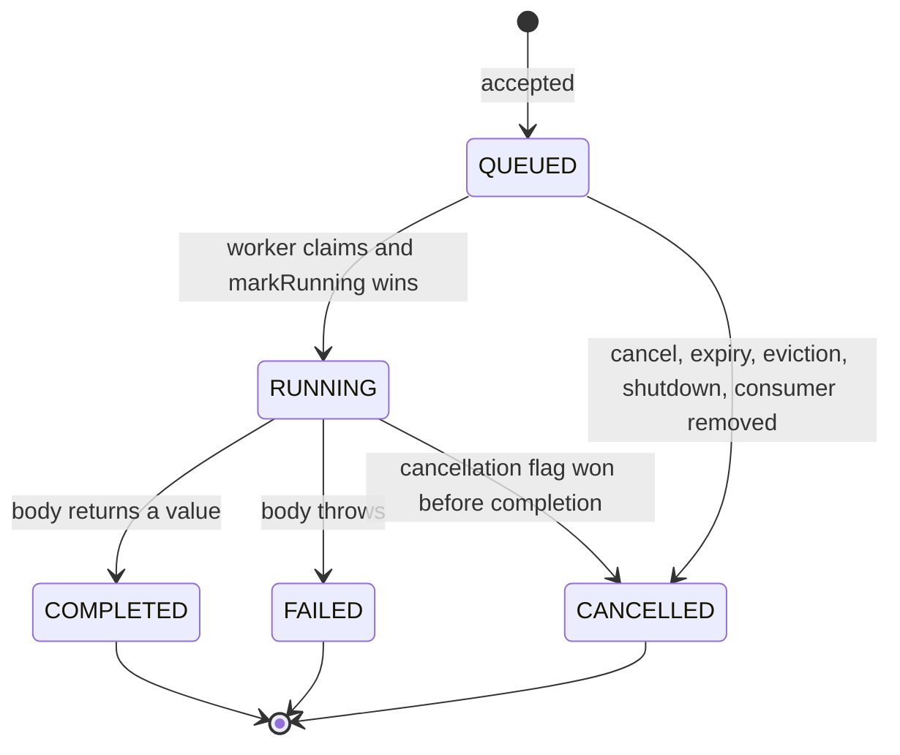

# Architecture

## Components



One engine owns exactly one queue, one worker pool and one metrics collector. Consumers are just ids with
policies; they do not own threads. The engine registers the `default` consumer and every configured
override at start, but it never registers a consumer on behalf of a subsystem: in this build nothing submits
under those ids until a plugin or a future subsystem does.

| Component | Responsibility | Source |
| --- | --- | --- |
| `AsyncComputeScheduler` | Public contract and thin facade over the engine | [`AsyncComputeScheduler.java`](../../tuff-compute/src/main/java/kz/bejiihiu/tuff/compute/AsyncComputeScheduler.java) |
| `ComputeEngineImpl` | Lifecycle, submission validation, handle ownership, wiring | [`ComputeEngineImpl.java`](../../tuff-compute/src/main/java/kz/bejiihiu/tuff/compute/internal/engine/impl/ComputeEngineImpl.java) |
| `BoundedComputeQueue` | Ordering, aging, fair share, capacity, eviction, expiry | [`BoundedComputeQueue.java`](../../tuff-compute/src/main/java/kz/bejiihiu/tuff/compute/internal/queue/impl/BoundedComputeQueue.java) |
| `AtomicQuotaController` | Per-consumer concurrency slots plus the pool-wide limit | [`AtomicQuotaController.java`](../../tuff-compute/src/main/java/kz/bejiihiu/tuff/compute/internal/queue/impl/AtomicQuotaController.java) |
| `DispatcherImpl` | Picks one entry per worker iteration, handles quota races | [`DispatcherImpl.java`](../../tuff-compute/src/main/java/kz/bejiihiu/tuff/compute/internal/engine/impl/DispatcherImpl.java) |
| `DynamicWorkerPool` | Reusable platform threads, keep-alive, resize, idempotent shutdown | [`DynamicWorkerPool.java`](../../tuff-compute/src/main/java/kz/bejiihiu/tuff/compute/internal/worker/impl/DynamicWorkerPool.java) |
| `QueueJanitor` | Expiry sweep, gauge sampling, autoscale reconciliation | [`QueueJanitor.java`](../../tuff-compute/src/main/java/kz/bejiihiu/tuff/compute/internal/engine/impl/QueueJanitor.java) |
| `AimdAdaptiveConcurrencyController` | Moves the concurrency limit from observed wait and execution | [`AimdAdaptiveConcurrencyController.java`](../../tuff-compute/src/main/java/kz/bejiihiu/tuff/compute/internal/adaptive/impl/AimdAdaptiveConcurrencyController.java) |
| `ComputeMetricsCollector` | Counters, latency histograms, throughput, gauges | [`ComputeMetricsCollector.java`](../../tuff-compute/src/main/java/kz/bejiihiu/tuff/compute/internal/metrics/impl/ComputeMetricsCollector.java) |

`ComputeSchedulers.create(settings)` is the only supported way to build a scheduler. It returns a scheduler
in `NEW`; it owns no thread until `start()`.

## Threading model

The pool uses **platform threads**, never virtual threads.

- Virtual threads add no parallelism to CPU-bound work; they only make blocking cheaper.
- A virtual worker disappears from a normal thread dump, and the scheduler needs workers that an operator
  can see and count.
- Each worker has a stable index used by the dispatcher's carry slot and by the optional stealing scan; a
  virtual thread is not a stable slot.
- The pool rejects a virtual thread from its `ThreadFactory` with `IllegalArgumentException`, so the
  property is enforced and not just documented.

Worker threads are named `<prefix>-<n>`; the remaining threads are named individually. All of them appear in
dumps, watchdog reports and JFR:

| Thread | Name | Count |
| --- | --- | --- |
| Workers | `Tuff Compute Worker-1`, `-2`, … | 1 to `max-threads` |
| Janitor | `Tuff Compute Worker-janitor` | 1 daemon |
| Adaptive timer | `Tuff Compute Worker-adaptive` | 1 daemon, only when adaptive is enabled |
| Shutdown | `Tuff Compute Worker-shutdown` | 1 daemon for the duration of shutdown |
| Metrics sampler | `Tuff Compute Metrics-1` | 1 daemon, only when metrics are enabled |

All of them are daemons. A task stuck in user code cannot keep the JVM alive after the server decided to
stop, and the server already has an explicit shutdown sequence.

Workers are **not** region threads. They own no region, chunk, entity or inventory. The division of labour
with Folia is strict:

- a worker computes from a snapshot captured on the owning thread;
- the result is delivered through a future;
- `ComputeHandoff` schedules the consumer on the region scheduler, the entity scheduler or the global
  region, so world mutation happens where Folia allows it.

The pool never touches the region scheduler and the region scheduler never touches the pool. There is no
lock shared between them.

### Pool-wide concurrency gate

The gate permits up to `concurrencyLimit` workers to be inside a task at once. The limit starts at the
initial worker count and is the number the adaptive controller moves. Lowering it does not revoke a permit
that is already held: running tasks finish, new claims wait. `idleWorkers()` counts live workers minus
permit holders, so a worker blocked by the gate reports as idle.

## Exactly-once invariants

These are the rules that make the accounting hold under cancellation, expiry, eviction, consumer removal
and shutdown racing each other:

1. **Only the task handle ends a task.** `TaskHandle` owns one `AtomicReference<State>` and is the only
   code that completes the caller's future. The queue, dispatcher, janitor, eviction listener and shutdown
   path only *request* a transition; the winner of the terminal compare-and-set performs it.
2. **Only the worker that received an entry releases its quota slot.** The dispatcher acquires a slot
   before returning an entry, so `taskFinished`, `taskCompleted` and `taskCancelled` are the only release
   points, and all of them run on the worker thread that holds the entry.
3. **A queued entry never held a slot, so it never releases one.** Cancellation, expiry, eviction, consumer
   removal and shutdown of queued work are pure handle transitions plus a metrics event.
4. **Exactly one terminal metrics event per accepted task.** The caller that won the handle's terminal CAS
   emits it. A cancellation that loses the race to a completion does nothing; a completion that loses to a
   cancellation discards the result and is counted as cancelled.
5. **Nothing leaves the queue silently.** `poll`, `steal`, `remove`, `drainTo`, `drainExpired`, `clear`,
   `unregisterConsumer` and the eviction listener all hand the entry back to the engine. The queue never
   completes a future itself, because only the engine can.
6. **A claimed entry cannot be executed twice.** The queue node is claimed with a CAS before it leaves the
   queue, and `TaskHandle.markRunning()` is a second CAS from `QUEUED` to `RUNNING`. A task whose body
   never starts is terminalized by the worker that claimed it.

If a worker loses the race for a consumer quota slot after polling, it keeps the entry in its own **carry
slot** instead of re-offering it. Re-offering could evict an innocent entry under `DROP_OLDEST` or
resurrect a retired consumer. If a worker dies while carrying, the entry moves to a small orphan queue that
any worker or the janitor can drain.

## Task lifecycle



`REJECTED` exists on the handle contract but is never returned to callers: a refused submission throws
`ComputeRejectedException` and no handle is produced.

A running task whose cancellation was requested is not interrupted. The body keeps running until it returns
or polls `isCancellationRequested()`; the result is discarded and the future completes with
`ComputeCancelledException`. This is why a task body that loops must check the flag itself.

## Scheduling

Every consumer stream is four buckets, one per priority, ordered by submission sequence. Selecting the next
task is: best head of each consumer, then best consumer.

| Strategy | Order |
| --- | --- |
| `FIFO` | Oldest submission wins; priority and weight are ignored. Benchmark baseline |
| `PRIORITY` | Highest effective priority wins, ties by submission order. Weights are ignored |
| `WEIGHTED_FAIR` | Highest effective priority wins; ties go to the consumer with the lowest virtual service time, then submission order |

### Aging

A task's effective level is

```
effective = min(CRITICAL, base + min(floor(waited / aging-interval), max-aging-boost))
```

Aging is recomputed from the bucket head's timestamp on every poll, so a waiting task climbs levels without
being moved between buckets, and the bucket head is always its best candidate. Aging can lift `LOW` to
`CRITICAL` in at most `max-aging-boost` steps, which is what stops a `CRITICAL` flood from starving the
rest.

### Weighted fair share

`WEIGHTED_FAIR` charges a dispatch turn to the consumer's virtual service counter:

```
charge = round(1_000_000 / fair-share-weight)
```

A weight of `2.0` is charged half as much per turn as `1.0`, so it gets roughly twice the turns while
queues are contended. A consumer that becomes runnable again after being idle is aligned to the least
served backlogged consumer, so an hour of unused turns cannot become an hour of monopoly. The counters are
rebased when they grow too large, which does not change their order.

Two consumers can still differ from their weights while one of them has nothing queued. Weight only
decides who gets the next turn when both have work.

### Work stealing

`work-stealing: true` lets an idle worker bypass normal consumer selection and take the head of a stream
starting from a rotating index, so idle workers do not all hit the same consumer. It is off by default and
the stream scan is bounded by the number of registered consumers.

## Bounded queue and the three failure paths

`queue.capacity` bounds the total number of **queued** tasks, not running ones. `consumers.<id>.max-queued-tasks`
bounds one consumer on top of that. Submission never blocks the caller; a full queue refuses or makes room.

| Path | Trigger | What happens | Caller sees |
| --- | --- | --- | --- |
| Reject | Global capacity or consumer queue bound reached, policy `REJECT` | Nothing is queued, no slot is consumed | `ComputeRejectedException` with `QUEUE_FULL` or `CONSUMER_QUEUE_FULL` |
| Drop oldest | Same bounds, policy `DROP_OLDEST`, the submitting consumer has a queued task | The oldest queued task **of that consumer** is cancelled | The new task is accepted; the evicted task's future fails with `ComputeCancelledException` `EVICTED` |
| Expire | `max-queue-wait` elapsed while queued | The janitor sweeps it, the task never runs | Future fails with `ComputeCancelledException` `QUEUE_EXPIRED` |

`DROP_OLDEST` never throws away another subsystem's work. If the submitting consumer has nothing queued,
the submission is rejected exactly like `REJECT`.

Expiry is a real periodic sweep, not a check on poll: a task that keeps losing to higher priority work
still leaves the queue when its wait limit passes. The janitor runs every 10–100 ms, so expiry is accurate
to that granularity.

Other refusals happen before the queue is touched: `SCHEDULER_DISABLED`, `CONSUMER_DISABLED`,
`CONSUMER_UNKNOWN` (dynamic registration off), `TASK_TYPE_NOT_ALLOWED`, `PRIORITY_NOT_ALLOWED`. None of
them occupy a queue slot, and all of them are counted in the rejection metrics.

> `queue.overflow-policy` is the overflow default for the `default` consumer and for consumers registered
> on the fly; `consumers.<id>.overflow-policy` overrides it. A consumer registered explicitly through the
> API carries the policy it was registered with.

## Cancellation

Cancellation is cooperative and has four entry points: `ComputeTaskHandle.cancel()`, cancelling the future
(which routes back to the handle), consumer removal, and shutdown.

- A queued task is removed from the queue immediately and its future fails with
  `ComputeCancelledException` (`CALLER`, `QUEUE_EXPIRED`, `EVICTED`, `SHUTDOWN`, `CONSUMER_DISABLED`).
- A task in a dispatcher carry slot is removed the same way.
- A running task is only flagged. The worker never interrupts it; the result is discarded when it arrives.
- Cancellation is idempotent and returns `false` when the task already ended or the request lost the race.

Removing a consumer is not cancellation of its running work: queued work of that consumer is cancelled
immediately with `CONSUMER_DISABLED`, while work that already started runs to completion and its future
completes normally with the produced value. This keeps a plugin disable from throwing away a half-finished
computation.

Because workers are never interrupted, a task that ignores the flag holds its slot until it returns. There
is no per-task timeout and no watchdog that kills it.

## Autoscaling

There are two mutually exclusive owners of pool size, and one source of truth for the number itself.

**Worker count.** A fixed `threads` is used as written. `threads: -1` resolves through
`ComputeSettings.Workers#resolveThreadCount(budget)`:

```
workers = clamp(max(min-threads, budget - 1), 1, ceiling)
ceiling = max-threads when set, otherwise max(min-threads, budget)
```

`budget` is the number of processors the platform grants the compute pool, not the raw core count. The
server computes it with `ComputeThreadBudget`:

```
budget = max(1, floor(cores * 0.8) - regionThreads - chunkWorkers - ioThreads - 4)
```

The engine never subtracts region, chunk or IO threads itself; doing both would leave the pool with far
fewer workers than the administrator asked for. The server resolves the budget and applies it with
`AsyncComputeScheduler#applyProcessorBudget(int)` once the region scheduler is up; the engine resizes the
pool, its concurrency gate and the quota limit on that call. Before the first call — and in a direct
construction — `Runtime.availableProcessors()` is used as the budget.

**Static autoscaler** (adaptive disabled, `threads: -1`): a submission that finds a backlog raises the
desired worker count by one when no worker is idle, and the janitor reconciles every tick towards
`min(ceiling, max(min-threads, active + backlog))`. Workers above the floor retire after `keep-alive-seconds`
of idleness. An explicit `threads` value pins the pool and disables this path.

**Adaptive controller** (`adaptive.enabled: true`, only with `threads: -1`): once per
`max(sample-window, 1 s)` it aggregates the last finished tasks in the window and computes average queue
wait `W`, average execution `C`, its p99, throughput `X`, demand `D = X * (W + C)` (Little's law) and
utilisation `rho = D / limit`.

It grows only when all of these hold: a backlog was observed, `W <= C`, `W99 <= 2C`, `rho >= target-utilization`,
and the process CPU load is below 90%. Growth is additive:
`clamp(round(limit * increase-step), 1, 4)`, and after a shrink it waits for two favourable windows.

It shrinks on latency pressure (`W >= 2C` or `W99 >= 4C`) or after three consecutive idle windows (empty
queue, utilisation below half the target). Failed tasks are not sampled; their timing says nothing about
capacity. The floor is `max(min-concurrency, min-threads)`, the ceiling is `min(max-concurrency, worker
ceiling)` or the worker ceiling when `max-concurrency` is `-1`; the processor budget is a hard cap on top of
that. An explicit worker count pins the limit and the controller reports `EXPLICIT_WORKER_COUNT`.

## Server lifecycle

The server owns the engine through `ComputeBootstrap`, which has three hooks:

| When | What happens |
| --- | --- |
| End of the `CraftServer` constructor, before plugins are enabled | `ComputeBootstrap.start()` reads `config/tuff.yml`, creates the scheduler with a conservative processor budget, starts it and publishes it through `TuffCompute.install` |
| Right after `RegionizedServer.init()` | `ComputeBootstrap.applyRegionBudget()` reads the region, chunk worker and IO thread counts, computes the real budget with `ComputeThreadBudget` and calls `applyProcessorBudget` |
| During `MinecraftServer#stopServer()`, after plugins are disabled and their async tasks finished, before the world save | `ComputeBootstrap.stop()` stops an active JFR recording, uninstalls the scheduler, calls `shutdown(grace)` and waits up to `grace + 5 s` for `TERMINATED` |

The startup budget cannot know the region threads yet, so it is `max(1, floor(cores * 0.8) - 4)`. Once
the regions exist, the pool is resized against what the rest of the server actually owns. A fixed
`workers.threads` count is never resized; the bootstrap logs that the budget was not applied. `/reload` does
not rebuild the engine.

With `async-compute.enabled: false` the engine is not created at all: no worker, janitor, adaptive or
sampler thread exists, nothing is installed, and `TuffCompute.scheduler()` is empty. The configuration is
still read and validated, and `/tuff` answers with the disabled explanation. A failure during startup is
logged under `Tuff/Compute` and leaves the server running without an engine (`FAILED`).

## Shutdown

`shutdown()` uses `shutdown-grace-seconds`. The engine:

1. moves to `SHUTTING_DOWN`, closes the queue to new offers;
2. cancels **all** queued work with `SHUTDOWN` immediately;
3. asks the pool to stop claiming, and gives running tasks the grace period to finish;
4. stops the janitor and the adaptive timer, closes the metrics collector, resets quotas;
5. moves to `TERMINATED` and releases `awaitTermination`.

Running tasks are never interrupted. If the grace period expires, the scheduler moves to `TERMINATED`
anyway: the tasks that are still running keep running and their futures complete normally (or with the
failure the body throws) after termination. `awaitTermination` therefore returns within roughly the grace
period even when a task hangs. `shutdownNow()` on the facade is the same sequence with a zero grace period,
and is not part of the public scheduler interface.

## Metrics and JFR

Metrics are collected from lifecycle events on the hot path: `LongAdder` counters, a log-linear latency
histogram for queue wait and execution, and a throughput meter sampled once per `sample-interval-seconds`.
Global queue depth and worker gauges come from the janitor's samples, so those values can be up to one
sample interval stale; everything derived from lifecycle events is current.

The CPU figure is the **process** CPU load from `OperatingSystemMXBean`, not a pool utilisation. It
includes tick threads, GC and JIT, and it is `NaN` when the runtime cannot provide it.

JFR is independent of metrics collection: with `metrics.jfr: true` the scheduler emits events even when
`metrics.enabled` is false. The recorder never fails a task; an event that cannot be emitted is dropped.
See [Operations](operations.md#jfr) for the event list and recording recipes. Measured costs and scaling
numbers are in [Benchmarks](benchmarks.md).

## Related pages

- [Plugin API](plugin-api.md)
- [Configuration](configuration.md)
- [Operations](operations.md)
- [Benchmarks](benchmarks.md)
