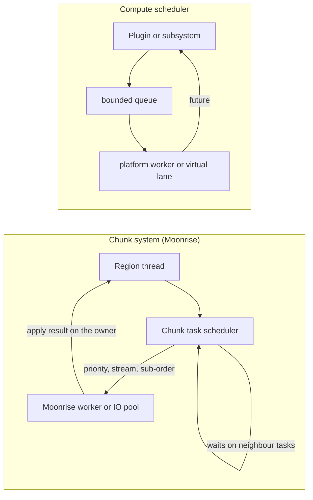

# Chunk system

The compute scheduler is not a replacement for the server's chunk system. The chunk system in this build
is Moonrise, running on LeafPile's concurrent utilities, and it already owns a worker pool and an IO pool.
This page explains why its tasks cannot simply be submitted to the compute queue, and what the supported
boundary between the two is.

There is deliberately no edge between the two boxes. A plugin submits independent work to the compute queue;
the chunk system keeps its own executor.

## What the chunk executor guarantees

The chunk system does not use a plain FIFO `ExecutorService`. Its executor is an ordered stream queue:

| Property | What it provides |
| --- | --- |
| Priority | Chunk work competes in named priority bands, not a single FIFO |
| Stream | Tasks that share a stream key run in submission order. The stream is the ordering domain |
| Sub-order | A second key that breaks ties between queues whose work overlaps in the chunk coordinate space |
| Dependencies | A chunk task can wait for other chunk tasks, for example a generation step waiting on neighbour chunks or a later status waiting on an earlier one |
| Drain contract | `halt()` stops the executor through a defined drain sequence; the chunk system relies on it to stop generation, loading and IO in order |

The ordering keys are not cosmetic. Two queues that cover overlapping chunk areas must not be able to hold
each other's next task: one queue waits for a task that is behind the other queue's head, and neither can
advance. The chunk scheduler therefore generates distinct sub-order values for overlapping queues. Remove
the stream and sub-order keys and the queue can still be bounded and prioritised, but it can no longer
guarantee that the work which unblocks a waiting task is allowed to run first.

## Why it does not translate to the compute queue

The compute queue orders by consumer, priority and submission sequence, with optional aging and fair share.
It has no stream key and no sub-order, and that difference is structural, not a missing option.

1. **Per-stream order would be lost.** Compute tasks of one consumer are ordered by priority and sequence.
   Two tasks for the same chunk can be dispatched in either order, and a later stage can start before the
   stage it depends on has produced its result. Adding a stream key would mean rebuilding the queue's
   selection and aging rules around an ordering domain the engine does not have.

2. **The dependency graph does not fit a bounded worker pool.** A chunk task often blocks on another chunk
   task. Moving the whole graph onto a fixed pool creates the classic starvation deadlock: every worker
   holds a task that waits for a task that cannot get a worker. A virtual lane reduces the cost of a blocked
   task but does not remove the cycle, because the dependency is not only a blocked thread — it is ticket
   and status state that must advance in order.

3. **`halt()` is not the compute shutdown contract.** On shutdown the compute engine closes the queue,
   cancels every queued task immediately, gives running bodies a grace period and then moves to
   `TERMINATED` even if some bodies are still running. That is correct for independent work and wrong for
   chunk work: cancellation or abandonment in the middle of a status progression leaves chunk holders and
   tickets in a state the world cannot use. The chunk system needs its own drain point and its own timeout.

4. **Area locks and ticket locks assume the chunk scheduler's order.** Chunk work takes area and ticket
   locks in an order Moonrise defines. A generic dispatcher that reorders work around those locks can
   produce a lock-order inversion that the chunk system was designed to avoid.

5. **Overflow semantics would destroy world work.** The compute queue refuses, evicts or expires work when
   it is full; those are reasonable outcomes for a cache warm-up or a speculative computation. A dropped
   chunk generation or an expired status task is not. The chunk system throttles by in-flight chunks and
   has its own backpressure; the compute queue's policies cannot replace it.

## What is done instead

- **The chunk system keeps its executors.** Generation, loading, IO, compression and saving stay on the
  Moonrise worker and IO pools. No chunk progression task is submitted to the compute scheduler in this
  build, and the engine does not wrap or proxy the chunk system's queues.

- **The compute engine is used for independent work around the chunk system.** The safe pattern is the same
  as for any other consumer: capture a snapshot on the owning thread, compute from the snapshot on a
  platform worker or the virtual lane, then deliver the result back with `ComputeHandoff` so world mutation
  happens on the region or entity that owns it. The task must not call `join()` on a chunk future, take a
  chunk ticket, or assume any chunk stream order.

- **Registration and observation are the only possible boundary.** The engine's public surface is consumer
  registration plus its own metrics and JFR; it does not observe another executor's queues. A chunk-system
  integration could therefore register an id for work it actually submits through the scheduler and be
  visible in those snapshots. It could not make Moonrise's internal queue visible, and it could not reorder
  it. No chunk-system consumer is part of this build: nothing from the chunk system is registered, and
  nothing is submitted.

If chunk work ever needs to share the compute engine's accounting, the ordered executor must remain the
authority for ordering and shutdown. The compute pool can run leaf computations that have no stream order
and no chunk dependency; it cannot become the executor for the chunk stream itself.
