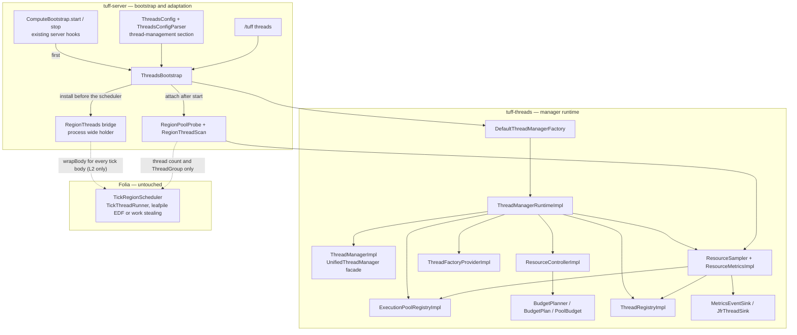
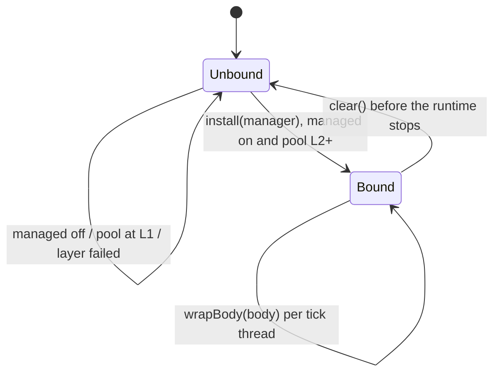
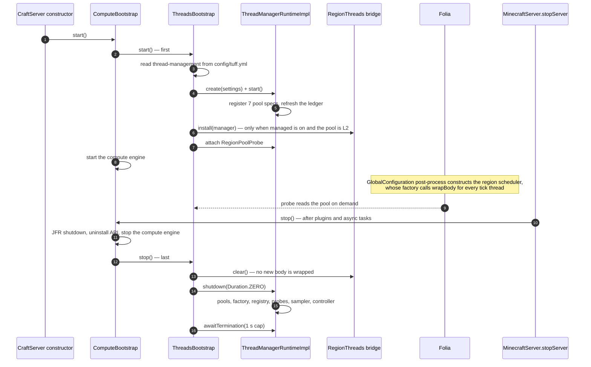

# Architecture

## Components



| Component | Responsibility | Source |
| --- | --- | --- |
| `UnifiedThreadManager` | Read-only facade for commands and subsystem owners: settings, pools, controller, factory, metrics, state | [`UnifiedThreadManager.java`](../../tuff-threads/src/main/java/kz/bejiihiu/tuff/threads/UnifiedThreadManager.java) |
| `ThreadManagerImpl` | Adds the manager's own degradation reasons to the measured snapshot; owns the lifecycle phase | [`ThreadManagerImpl.java`](../../tuff-threads/src/main/java/kz/bejiihiu/tuff/threads/internal/runtime/ThreadManagerImpl.java) |
| `ThreadManagerRuntimeImpl` | Assembles the components in dependency order and drives start and shutdown | [`ThreadManagerRuntimeImpl.java`](../../tuff-threads/src/main/java/kz/bejiihiu/tuff/threads/internal/runtime/ThreadManagerRuntimeImpl.java) |
| `DefaultThreadManagerFactory` | Builds a runtime from clock, topology and event sink; no side effects until `start()` | [`DefaultThreadManagerFactory.java`](../../tuff-threads/src/main/java/kz/bejiihiu/tuff/threads/internal/runtime/DefaultThreadManagerFactory.java) |
| `DefaultPoolSpecs` | The canonical pool set registered at start, with coverage and budget derived from the settings | [`DefaultPoolSpecs.java`](../../tuff-threads/src/main/java/kz/bejiihiu/tuff/threads/internal/runtime/DefaultPoolSpecs.java) |
| `ExecutionPoolRegistryImpl` | Idempotent registration by id, kind conflicts rejected, immutable spec collections | [`ExecutionPoolRegistryImpl.java`](../../tuff-threads/src/main/java/kz/bejiihiu/tuff/threads/internal/impl/pools/ExecutionPoolRegistryImpl.java) |
| `ThreadResourceController` | The only blocking method in the module (`acquire` with a wait), permit ledger, saturation | [`ResourceControllerImpl.java`](../../tuff-threads/src/main/java/kz/bejiihiu/tuff/threads/internal/impl/controller/ResourceControllerImpl.java) |
| `BudgetPlanner` | Divides the processor headroom into per-pool budgets, once per ledger | [`BudgetPlanner.java`](../../tuff-threads/src/main/java/kz/bejiihiu/tuff/threads/internal/impl/budget/BudgetPlanner.java) |
| `ThreadFactoryProvider` | Creates platform threads from a spec, or wraps a body for threads someone else constructed | [`ThreadFactoryProviderImpl.java`](../../tuff-threads/src/main/java/kz/bejiihiu/tuff/threads/internal/impl/factory/ThreadFactoryProviderImpl.java) |
| `ThreadRegistry` | Live threads by pool, monotonic creation and termination counters, per-thread snapshots | [`ThreadRegistryImpl.java`](../../tuff-threads/src/main/java/kz/bejiihiu/tuff/threads/internal/impl/registry/ThreadRegistryImpl.java) |
| `ResourceSampler` | One sampling pass over registry, probes and JVM counters; driven by the bootstrap's refresher thread | [`ResourceSampler.java`](../../tuff-threads/src/main/java/kz/bejiihiu/tuff/threads/internal/impl/metrics/ResourceSampler.java) |
| `JfrThreadSink` | `tuff.threads.*` events, gated on `EventType.isEnabled()` | [`JfrThreadSink.java`](../../tuff-threads/src/main/java/kz/bejiihiu/tuff/threads/internal/impl/events/JfrThreadSink.java) |
| `ThreadsBootstrap` | Server seam: reads the config, starts and stops the runtime, installs the region bridge, takes the snapshot the command prints | [`ThreadsBootstrap.java`](../../tuff-server/src/main/java/kz/bejiihiu/tuff/threads/bootstrap/ThreadsBootstrap.java) |
| `RegionThreads` | The only Folia call site: wraps a region tick body for accounting, or returns it unchanged; never creates a thread | [`RegionThreads.java`](../../tuff-server/src/main/java/kz/bejiihiu/tuff/threads/bridge/RegionThreads.java) |
| `RegionPoolProbe` | Observe-only reading of Folia's region tick pool | [`RegionPoolProbe.java`](../../tuff-server/src/main/java/kz/bejiihiu/tuff/threads/probe/RegionPoolProbe.java) |

`tuff-threads` imports no Minecraft, Bukkit, Paper or Folia type. Everything that needs Folia lives in
`tuff-server`: the probe, the thread-group scan, the bridge and the bootstrap.

## Modules and ownership

| Module | Package | What lives there |
| --- | --- | --- |
| `tuff-threads` | `kz.bejiihiu.tuff.threads` | Public contracts: `UnifiedThreadManager`, `ExecutionPoolRegistry`, `ThreadResourceController`, `ThreadFactoryProvider`, `ResourceMetrics`, the data records and the settings model |
| `tuff-threads` | `kz.bejiihiu.tuff.threads.internal.*` | Implementation and internal SPI. No compatibility promise outside the module |
| `tuff-server` | `kz.bejiihiu.tuff.threads.bootstrap` | Server seam, config loading, `/tuff threads` text, the sampler |
| `tuff-server` | `kz.bejiihiu.tuff.threads.bridge` | The single call site Folia uses: body wrapping for the region pool |
| `tuff-server` | `kz.bejiihiu.tuff.threads.probe` | Region pool probe and thread-group scan |

## Coverage levels

The program measures integration depth per pool on five levels. A pool can be registered and observed
without anything about its execution changing, and that is the default.

| Level | Meaning | What it gives the operator |
| --- | --- | --- |
| **L0** | Outside the centre, documented exception | Nothing; the pool is invisible to UTMI |
| **L1** | Registered and observed (metrics only) | Pool identity, thread counts, active and idle, saturation where measurable, ownership answers |
| **L2** | Threads are created through `ThreadFactoryProvider`, or their bodies are wrapped by it when the owner must keep the thread class | Names, daemon flag, handler, accounting, lifecycle visibility |
| **L3** | Capacity is set by the resource controller | Dynamic limits, protection of critical pools |
| **L4** | Execution runs through a managed lane of UTMI | Full control plus a single queue |

Registration is not merging. A pool at L4 of the compute engine is still the compute engine's pool:
UTMI decides how much capacity it gets and accounts its threads, not how its tasks are ordered.

L2 has two shapes in this build. The manager either **creates** the thread (`service`, and the compute
workers once the adapter is on), or the owner creates it and the manager only **wraps the body**
(`region-execution`, and the compute virtual lane). `CoverageLevel.managesThreads()` is true for both,
because in both cases every live thread is registered while its body runs; the difference is that a
wrapped thread's class, name, group, daemon flag and exception handler stay the owner's.

### The five pool kinds

`PoolKind` fixes how a pool is treated when the budget is tight:

| Kind | Pools | Treatment |
| --- | --- | --- |
| `REGION_EXECUTION` | `region-execution` | Critical. Fixed size, protected minimum, never shared with compute |
| `COMPUTE` | `compute` | Elastic. Yields capacity first |
| `CHUNK`, `IO` | `chunk-worker`, `chunk-io` | Specialised. Ordering and shutdown order belong to the chunk system |
| `NETWORK` | `network` | Critical. Event loops own their channels and cannot be parked |
| `SERVICE`, `VIRTUAL` | `chat`, `background`, `service`, `compute-virtual` | Small / blocking lanes; virtual threads add no CPU parallelism |

## Current matrix

What the running layer actually registers and measures in this build:

| Pool id | Kind | Registered coverage | Live numbers | Threads created by UTMI | Capacity from the ledger |
| --- | --- | --- | --- | --- | --- |
| `region-execution` | `REGION_EXECUTION` | L1; L2 when `region-execution.managed: true` | Yes, through the probe | No; at L2 their bodies are wrapped for accounting | No |
| `compute` | `COMPUTE` | L1; L4 when `execution-pools.compute.managed: true` (or the older `async-compute.managed`) | Yes, through the engine probe | Yes at L4, through the compute adapter | Yes at L4; the controller's budget is the engine's single source |
| `compute-virtual` | `VIRTUAL` | L1; L2 with the same compute flag | Yes, through the engine probe | The lane creates its virtual threads; their bodies are wrapped | No |
| `chunk-worker` | `CHUNK` | L1; L2 claim when `execution-pools.chunk-system.managed: true` | Yes, through the Moonrise pool probe (`alive`, `core`) | No | No |
| `chunk-io` | `IO` | Same flag as `chunk-worker` | Yes, through the Moonrise IO probe (`alive`, `core`) | No | No |
| `network` | `NETWORK` | L1; L2 claim when `execution-pools.network.managed: true` | Yes, through the netty name scan (`alive`, `active`, `idle`) | No | No |
| `chat` | `SERVICE` | L1 | Yes, through executor counters and the thread name scan | No | No |
| `background` | `SERVICE` | L1 | Yes, through the `ForkJoinPool` counters and the thread name scan | No | No |
| `service` | `SERVICE` | L2 for the registered pool; only the sampler is in it | Yes, the sampler thread | Yes, one daemon | No |

`region-execution` is the only pool with tick-health data. Every other specialised pool has its own
cheap probe; `service` is accounted through the registry (the refresher thread), not a probe. Queue
depths are still `-1` where the owner does not expose one, so a printed `unknown` is a real statement.

`region-execution` at L2 is the one place where "threads created through the provider" is read as
"bodies wrapped by the provider": Folia constructs and owns the `TickThreadRunner` because the tick
class is checked on every tick, and only the runnable it runs is passed through
`ThreadFactoryProvider.wrap`. Accounting and lifecycle visibility are what L2 buys here; the thread
itself never leaves Folia.

The `chunk-worker`, `chunk-io` and `network` flags only raise the registered level. The probes are
attached at L1 regardless, so the numbers are real either way; no owner hands a factory or a body to
the manager yet, so treat the deeper level as a registration claim, not as proof of accounting.
[`coverage.md`](coverage.md) keeps the per-pool map with the reason each pool stops where it does.

## Region bridge and installation order

`RegionThreads` is a process-wide holder, because Folia's scheduler has no instance to hand over. Its
lifecycle is one `install` and one `clear`, both driven by `ThreadsBootstrap`:



Rules the bridge is built around:

- **Install before the scheduler exists.** `ThreadsBootstrap.start()` runs inside the `CraftServer`
  constructor, calls `RegionThreads.install(manager)` right after the runtime starts, and only later
  does `GlobalConfiguration`'s post-process construct `TickRegionScheduler`. This order is required,
  not cosmetic: `ThreadFactoryProvider.wrap` asks the registry for a pool at L2 or deeper and throws
  when the pool is missing, and the scheduler's factory calls the bridge while it is being constructed.
- **One line in Folia.** Patch `0016` changes exactly one expression in the thread factory: the
  `Runnable` handed to `new TickThreadRunner(group, run, name)` becomes
  `RegionThreads.wrapBody(run)`. Class, name, group, daemon flag and uncaught handler stay as they
  were, and `setUncaughtExceptionHandler` is still called on Folia's thread.
- **Never throw.** A missing binding, a pool below L2 or a provider that refuses makes `wrapBody`
  return the original `Runnable`. A failed wrap costs accounting, never tick threads; the failure is
  logged once per process.
- **Register on start, unregister in `finally`.** The wrapper calls the registry when the body begins
  and removes the thread when it ends. A `Throwable` from the body is not caught, so it still reaches
  Folia's handler that halts the scheduler and stops the server.
- **Clear before the manager stops.** `ThreadsBootstrap.shutdown()` clears the binding before
  `runtime.shutdown()`, so no body created during teardown is wrapped. A body wrapped earlier keeps
  its wrapper and unregisters on exit; the registry allows removal after stop.

## Subsystems and targets

| Subsystem | Now | Target | Why not higher |
| --- | --- | --- | --- |
| Region tick threads | L1; L2 with `region-execution.managed: true` | L3 requires work-stealing | Tick order, region ownership and the thread class stay Folia's; the EDF pool cannot be resized |
| Global region tick | Runs on the region pool | L2 | It is a scheduled handle, not a separate thread |
| Compute platform workers | L4 with `execution-pools.compute.managed: true`, L1 otherwise | L4 (done) | The engine already owns execution; the adapter decides threads and budget only |
| Compute virtual lane | L2 with the same flag, L1 otherwise | L2 | The lane owns its virtual threads and permits; the manager refuses to create a virtual thread |
| Chunk workers and chunk IO | L1; L2 claim with `execution-pools.chunk-system.managed: true` | L2, L3 carefully | Ordered streams and sub-order sequencing: a different queue deadlocks generation |
| Netty event loops | L1; L2 claim with `execution-pools.network.managed: true` | L2 | An event loop owns its channels; it cannot be parked or shared |
| Service and IO pools (`Util`, `MCUtil`, command builder, profiles) | L2 for the sampler only, L0 for the rest | L2, L3 for the background pool | Each pool has its own blocking contract and shutdown position |
| Plugin async schedulers | L0 | L2 | The contract is "start immediately" (`SynchronousQueue`), not "queue and wait" |
| Watchdogs, shutdown threads, console | L0 | L0, permanently | Lifecycle matters; scheduling must not change |
| JDK carrier threads, spark, log4j, JLine | L0 | L0 / L1 (visible only) | Not ours; the only lever is a system property or observation |

[`coverage.md`](coverage.md) expands this into a per-pool matrix with the exact ceiling and the proof
for each stop.

## Budget model

The ledger answers one question: how many threads may the managed pools have together without
oversubscribing the machine. It is computed once per ledger and has a one-line printable form,
`BudgetPlan.ledger()`, shaped like
`cores N: ceiling C = region R + chunk K + io I + reserve V + usable U`.

```
ceiling = floor(availableProcessors × 0.8)
usable  = max(1, ceiling − regionThreads − chunkThreads − ioThreads − max(1, reserveCores))
```

- `availableProcessors` comes from the platform topology view, container aware, never from a static
  table. `cpu-aware: false` is a diagnostic, not a sizing mode.
- The reserve is floored at one core. A machine with nothing left for the kernel, GC and JIT does not
  get faster when a pool takes the last core. The configured value is reported as given; the floor is
  visible in the plan.
- `usable` is floored at one so the arithmetic stays total, but `rawUsable` keeps the true number.
  When the subtraction reaches zero or below, the plan reports itself degraded and names every term.
- Pools whose threads were already deducted resolve against their own population (a lease for a tick
  is only useful while a tick thread exists). `NETWORK` resolves against the ceiling because netty
  threads are not part of the deductions yet. `COMPUTE`, `SERVICE` and `VIRTUAL` share `usable`.
- Shared caps that add up to more than `usable` are divided proportionally, largest remainder first,
  id order as the tie breaker. The plan says so instead of handing every elastic pool a full
  `usable`.
- A pool whose ceiling ends up below its declared minimum is **not** expanded silently. The plan is
  degraded, `BUDGET_EXHAUSTED` reaches the manager state and the text names the pool and both numbers.
  The plan also reports itself degraded when the shared caps had to be divided or the reserve could not
  be honoured — any reason makes the ledger "not followed as written".
  The one exception is explicit policy: `REGION_EXECUTION` and `NETWORK` keep their declared minimum
  and the overshoot is reported as an overcommit, because taking tick threads or event loops away is
  worse than oversubscribing by a core.

Two limits of the current build are worth stating plainly:

1. **Deductions are incomplete.** Only the region count is known from `thread-management`: it comes
   from `region-execution.threads` and is zero when that key is `-1`. Chunk worker and IO counts are
   passed as zero because this module cannot read `paper-global.yml`. The ledger is therefore
   optimistic on any server that runs chunk threads, and it models the configured region size, not
   the live one.
2. **The ledger sizes exactly one pool.** Compute is the only pool whose capacity is derived from it:
   with `execution-pools.compute.managed: true` the engine takes its worker count from
   `ThreadResourceController` through the adapter and `ComputeThreadBudget` is not called at all.
   Without that flag the engine still sizes itself from `ComputeThreadBudget`, which subtracts the
   **live** region, chunk and IO counts and a fixed network reserve. The two formulas share the 80%
   rule and nothing else, and the one that runs is printed at startup.

There is exactly one `usable` number. `ThreadResourceController.usableCores()` returns the plan's
`usable`, the snapshot publishes that same value, and `/tuff threads` prints it on its `cores:`
line. `reservedCores` next to it is the configured reserve, before the plan floors it at one. The raw
subtraction, which may be zero or negative, is visible in the printable ledger
(`ThreadResourceController.budgetLedger()`, also carried by the snapshot as `budgetLedger`) rather than
in a second "usable" field.

## Thread safety

The module is designed so that a command, a probe or a shutdown can never block a tick.

- **Immutable public types.** Specs, snapshots, budgets and the settings tree are records with
  validating constructors. The only mutable public handle is `Lease`, and only through its idempotent
  `release()`.
- **One lock in the controller.** Permit decisions, the in-use counters, parked waiters and the
  per-thread permit count live under one lock. The lock is held while deciding and while parking a
  waiter, never while running user code, and the event sink is called outside it. A parked request
  holds no permit; the permit is taken at grant time. Release is idempotent through a CAS in the
  lease. Closing the controller wakes every waiter with an `IllegalStateException` instead of letting
  it time out.
- **No interrupts.** A lease never kills work. An expired deadline is a degraded metric (`LeaseTimeout`),
  not a thread interruption; the same rule keeps shutdown cooperative.
- **Region threads never wait.** A request with `maxWait > 0` from a thread accounted to
  `region-execution` is rejected with `IllegalStateException`. The answer is registry-first; the name
  `Folia Region Scheduler Thread …` is only a fallback for threads nobody registered, so a renamed
  tick thread is still classified correctly and a plugin pool with a similar name is not.
- **The registry is lock-light.** Concurrent maps, monotonic counters, unregister in a `finally` so a
  dead thread is not counted. A registration that lands after the registry stopped is rejected rather
  than resurrecting accounting.
- **One refresher thread owns the expensive reads.** Folia runs console commands on a global region
  tick thread, so the command cannot walk regions or enumerate threads. The `Tuff Threads Sampler`
  daemon takes one pass per second (one walk over registered threads, one `observe()` per attached
  probe, one CPU read per thread, one forced unaccounted-thread scan) and publishes an immutable
  sample; the command only copies it and prints its age. The scan is forced on the same one-second
  clock as the pools, not throttled separately, so the unknown count moves with the rest of the
  sample.
- **Lifecycle under one monitor.** Start, shutdown and `awaitTermination` share a single monitor.
  Shutdown never joins, sleeps or interrupts; `awaitTermination` is the only call allowed to block
  and the bootstrap caps it at one second.

`-1` always means "not measured", never zero: queue depth without a probe, CPU without a baseline,
CPU time without MXBean support, unaccounted threads with metrics disabled. An operator must be able
to tell "idle" from "we do not know".

## Lifecycle



Order rules that the integration depends on:

- **Start before the compute engine.** The thread layer only registers pools and attaches probes, so
  the engine starts into a world where its pool already exists. This is also before Folia creates the
  region scheduler, which is why the region pool is registered without a live size: the probe reads
  the live count later, and the bridge must already be bound when the scheduler's factory asks for
  the first tick body.
- **Stop after the compute engine.** Compute workers get their grace period and the accounting layer
  goes away last. The reverse order would make factory calls fail while workers still respawn.
- **Nothing in the watchdog window.** Between Folia's `running = false` and `hasStopped = true`, the
  Spigot watchdog is still armed and the tick counter is frozen. Any join, await or heavy scan there
  is indistinguishable from a hung server and ends in an abnormal exit. The thread layer therefore
  has no shutdown hook of its own and does no blocking work in `shutdown()`; sampling is pull-based,
  so nothing samples in that window unless someone runs the command.
- **No `Runtime.addShutdownHook`.** The server already has its shutdown thread and an explicit exit
  path; a second hook would race it.

## What must not be touched

These are the invariants the layer is built around. Breaking any of them changes Folia's semantics,
not UTMI's.

| Invariant | Why | Where it is enforced |
| --- | --- | --- |
| Region threads stay Folia's `TickThreadRunner` subclass, in Folia's thread group, non-daemon, with Folia's uncaught-exception handler | The scheduler rejects any other class in the tick path and `AsyncCatcher` refuses world access outside a tick thread; the handler is what stops the server after an `Error` in a tick | `TickRegionScheduler.setTickingRegion`, `setTickTask`; `TickThread` |
| Only the tick body is wrapped; the bridge never creates, renames or replaces a region thread | L2 here is accounting, not ownership: a new thread object would fail the class checks above, and a renamed thread breaks operators and profilers | `RegionThreads.wrapBody`; `ThreadFactoryProvider.wrap` |
| Region ownership and tick order are never bypassed | Ticks are serialised per region by a state machine under the regioniser's lock; a second execution path breaks exactly-once tasks and merge/split | `ThreadedRegion.tryMarkTicking` / `markNotTicking` |
| EDF is not resized | The EDF scheduler fixes its thread arrays and idle bitset at construction and has no resize API; `setThreads` is a silent no-op for EDF. A thread-count change needs a restart | `TickRegionScheduler.setThreads`, leafpile `EDFSchedulerThreadPool` |
| The `Scheduler` is never decorated | `start()` and `setThreads()` test the concrete class, so a wrapper compiles but never starts the threads | `TickRegionScheduler.start` |
| Chunk ordered streams keep their queues and sub-order | Overlapping queues need different sub-order values; replacing them with a plain FIFO deadlocks chunk generation | `ChunkTaskScheduler`, `AreaDependentQueue` |
| Netty event loops keep ownership of their channels | A blocked or parked event loop stalls every connection on it; graceful shutdown of those loops is outside the server's own shutdown chain | `EventLoopGroupHolder` |
| `halt` / `join` semantics stay as they are | `halt` is cooperative (flag plus unpark) and `join` waits up to 60 seconds, then the shutdown dumps traces and continues. Adding an interrupt changes the shutdown contract | `RegionShutdownThread` |
| Region ids and tick handles are not cached | A split creates new region ids, a merge kills one, and deactivation replaces the handle with a copy; identity is not stable across samples | `TickRegions`, `ThreadedRegionizer` |
| Thread names are an operational contract | Operators, log parsers and profilers match on `Folia Region Scheduler Thread`, `Tuff Compute Worker` and the netty prefixes. Renaming is a visible change and is not part of thread management | `TickRegionScheduler`, `ThreadFactoryProviderImpl` |
| The JDK's virtual-thread carriers are not ours | They are shared with plugins and only reachable through `jdk.virtualThreadScheduler.*` | JDK |

## Related pages

- [Coverage](coverage.md) — the L0–L4 matrix per pool, the ceiling of each and what stays outside UTMI.
- [Configuration](configuration.md) — the section, defaults and restart behaviour.
- [Observability](observability.md) — the command, the snapshot, JFR and the honest limits of tick
  metrics on a regionised server.
- [Compute architecture](../compute/architecture.md) — the pool that reaches L4 when its management
  switch is on.
